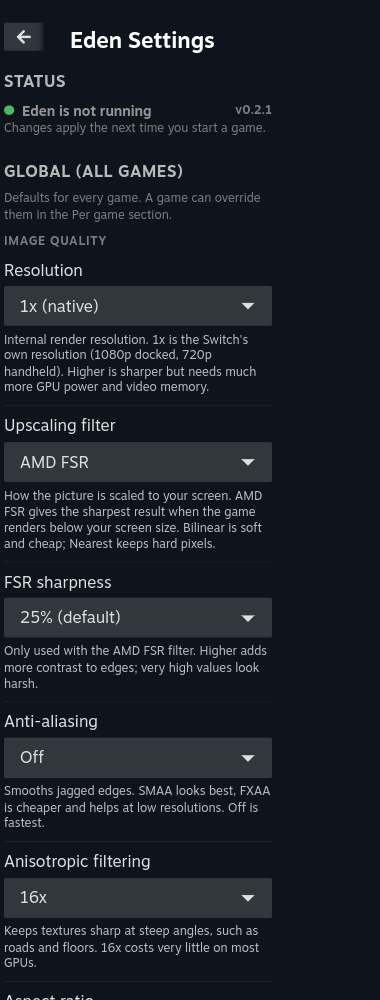
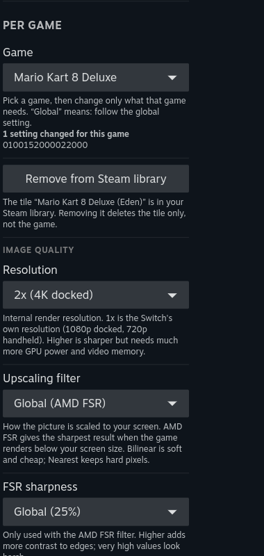
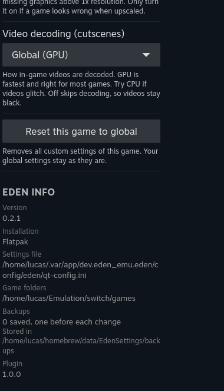

# Eden Settings for Decky

Change the settings that matter in **[Eden](https://eden-emu.dev)** (the Nintendo Switch emulator) straight from
Game Mode, globally or per game, with a plain-language explanation for every option. No more switching to Desktop
Mode to change a resolution.

| Global settings | Per game | Eden info |
| --- | --- | --- |
|  |  |  |

## Features

- **15 curated settings** in three groups: *Image quality* (resolution, upscaling filter, FSR sharpness, anti-aliasing,
  anisotropic filtering, aspect ratio), *Performance* (console mode, video memory use, VSync, speed limit, GPU clock,
  asynchronous shaders) and *Compatibility* (rescale hack, video decoding).
- **Global and per game.** Pick a game and change only what it needs. *Global* means "follow the global setting", and
  the dropdown shows what that currently is.
- **Steam shortcuts.** One button per game adds a Game Mode tile (name, launch options, generated artwork and icon)
  that starts Eden fullscreen with that game, and removes it again. Tiles you already made by hand are recognised.
- **Every option explained**, in your language: what it does, what it costs and when to use it.
- **Eden info** at the top and bottom of the panel: running or not, version, installation type, settings file, game
  folders and backups.
- **Safe.** Nothing is written while Eden runs (Eden rewrites its own files when it closes, which would undo your
  change). Before every write the file is backed up (the last 20 are kept), the write is atomic, and only the lines of
  the setting you changed are touched. Unknown or invalid values are refused.
- **Languages:** English (default), Dutch, German, French and Spanish. The plugin follows Steam's language; anything
  untranslated falls back to English.

## Requirements

- Steam Deck, Bazzite, SteamOS or any Linux with Steam Game Mode and [Decky Loader](https://decky.xyz).
- Eden installed as a **Flatpak** (`dev.eden_emu.eden`, user or system) or as a native/AppImage build whose settings
  live in `~/.config/eden` (native detection is best-effort and untested). Start Eden once so that it creates its settings file.

## Install

- **Manually (for now):** download `EdenSettings-<version>.zip` from the [latest release](https://github.com/simkin/decky-eden-settings/releases/latest), extract it to `~/homebrew/plugins/EdenSettings` (the folder must contain
  `plugin.json`, `main.py`, `dist/` and `py_modules/`), then restart Decky (`sudo systemctl restart plugin_loader`).

## Using it

1. Open the Quick Access Menu → Decky → **Eden Settings**.
2. Under **Global**, change what you want for every game.
3. Under **Per game**, pick a game and override only what it needs. Use *Reset this game to global* to undo.
4. Start the game. Changes apply the next time a game starts.

If Eden is still running the panel is locked. Close the game first (**Steam+B** in Game Mode).

### Steam shortcuts

Under **Per game**, *Add to Steam library* creates a non-Steam shortcut through Steam's own API (no Steam restart,
no editing of `shortcuts.vdf`) and draws the library artwork. *Remove from Steam library* deletes only the tile.

- The tile starts `~/homebrew/data/EdenSettings/launch-eden`, a small script the plugin writes (and refreshes) itself.
  It runs Eden fullscreen (`-f -g <game>`) and logs to `/tmp/eden-settings-launch.log`.
- **Pre-launch hook:** an executable `~/.config/eden-settings/pre-launch` is run first, with the game path as its
  argument. Use it for things like assigning controllers.
- **Artwork:** the plugin cannot read icons out of game files. Put `<TitleID>-icon.jpg` (or `.png`, 256x256 or larger,
  for example `0100ABCD01234000-icon.jpg`) in an `artwork` folder next to your games folder (or in
  `~/Emulation/switch/artwork`) and the tile gets the icon on a blurred background. Without it the artwork only
  shows the title.
- Shortcuts are matched on the game's title ID, so tiles that already exist are shown as "Remove", not added twice.

### Where games come from

The plugin lists games it finds in the folders of Eden's game list, plus `~/Emulation/switch/games`,
`~/Emulation/roms/switch` and `~/ROMs/switch`. A game is a `.nsp` or `.xci` file that has its title ID in the name,
like `Name [0100ABCD01234000][v0].nsp` (scanned up to 3 folders deep). Games that already have a per-game config in
Eden are always listed, by title ID if no file is found.

## Languages

Texts live in `src/locales/<code>.json`; `en.json` is the source. To add a language:

1. Copy `src/locales/en.json` to `src/locales/<code>.json` and translate the values (keep the `{placeholders}`).
2. Import it in `src/i18n.ts`, add it to `LOCALES` and, if Steam uses a different name for it, to `STEAM_LANGUAGES`.
3. Run the tests (`pnpm test`): they check that every key exists, that placeholders match and that option labels are
   short enough for a dropdown button.

To try a language without changing Steam's, run in the Steam dev console:
`localStorage.setItem("eden-settings-language", "de")` (use `removeItem` to return to automatic).

## Development

```sh
pnpm install
pnpm build          # -> dist/
pnpm test           # python unit tests (config logic + locales)
tools/deploy.sh     # build, copy to ~/homebrew/plugins/EdenSettings and restart Decky (Linux, sudo)
tools/qam.sh        # screenshot the real panel via Steam's CEF debug port (8080)
```

- `py_modules/eden_cfg.py` is pure Python with no Decky dependency, so it can be tested on its own. It knows the
  Qt-INI format Eden uses (`key\default`, `key`, `key\use_global`) and the schema of supported settings.
- The backend sends keys and values only; all human-readable text lives in the frontend locales.
- To add a setting, add it to `SETTINGS` in `eden_cfg.py` (verify the enum order against Eden's `settings_enums.h`
  and a real `qt-config.ini`), then add its `setting.*` and `option.*` texts to `en.json` (the tests tell you what is
  missing in the other languages).
- Decky's embedded Python has no `xml.etree`; keep the backend to the plain standard library.

## Notes and limits

- Only settings whose values have been checked against Eden's source are offered. Eden has many more; ideas and
  pull requests are welcome.
- Resolution scaling above 1x breaks a few games (black or missing graphics). Try the *Rescale hack*, or go back to 1x.
- Eden's *Surround* audio option is intentionally not included: at the time of writing Eden still opens a 2-channel
  stream regardless of it.
- The plugin edits Eden's configuration files directly. Backups are in
  `~/homebrew/data/EdenSettings/backups`.

## License

BSD-3-Clause, see [LICENSE](LICENSE). Not affiliated with the Eden project.

## Transparency

This plugin was written with substantial help from an AI coding assistant (Claude Code) and was tested on Bazzite
(Game Mode, Steam Controller). It is therefore not eligible for the official Decky store, whose rules do not accept
mostly AI-written code; install it from the release zip instead.
